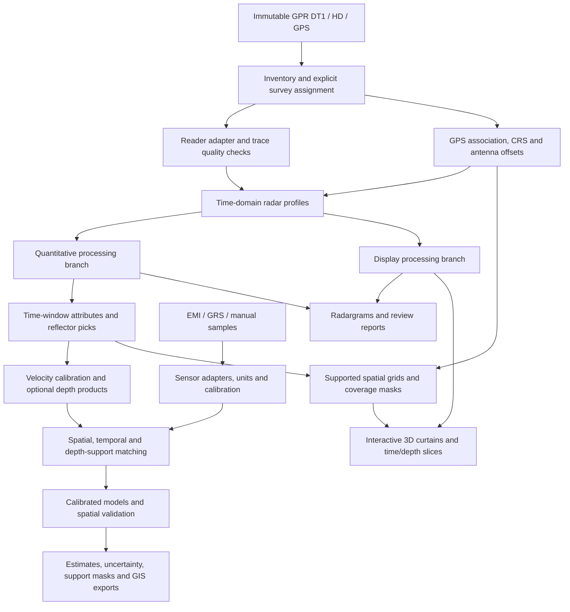

# Architecture

The real-data M7 revision adds `volumes/collection.py` to freeze complete parent
grid memberships from verified collection runs. Crossing directions remain in
one explicitly combined diagnostic cube, with direction counts and native
proximity comparisons retained. RMS uses finite local window support, while
Hilbert retains whole-trace clipping exclusion. The viewer packages lossless
binary arrays and renders supported cell boundaries, cutaways and plan maps;
display geometry never modifies scientific arrays. See [volume_makeover.md](volume_makeover.md).

Current implementation: M0–M3 tooling and the manual-texture foundation of M4 are
complete. M4.5 scene construction, support-masked interpolation and offline export
are implemented and reviewed in a synthetic WebGL browser session. The comparison
overview uses full-resolution plan maps; selected plots use 3D curtains/slices. See
[reader decision](dt1_reader_decision.md) for verified backend/timing behavior and
[implementation plan](implementation_plan.md) for remaining stages. Sections below
describe the full intended workflow; calibrated field fusion, inference and GIS
products still require field metadata/data.

M5 implements evidenced calibration, spatial evaluation and portable numerical
models. M6 wraps completed runs in GIS exports and portable reports. `runs.py`
records immutable inputs, code/environment identity and artifact hashes;
`batch.py` resolves an explicit dependency DAG and reuses only verified completed
results with matching source/configuration/code/environment fingerprints.
`export/gis.py` isolates Rasterio/GeoPandas adapters and checks reopened products.
`export/report.py` bundles declared artifacts and renders held-out residual maps.
`demo.py` composes these public functions using explicit synthetic inputs. The
optional `visualization/preview.py` is a read-only, synthetic-only loopback viewer;
it is not a scientific processing service or a requirement for exported HTML.

M7 adds `volumes/` for frozen selections, capability gates, horizontal stencils and
bounded vertical-block writes. Schema 1.0 is independent of M4.5 geographic grids.
Raw-GPS volumes retain null CRS and production plot ID; geographic validators stay
strict. `processing/attributes.py` computes signed/envelope/RMS products before
horizontal binning. Each variable has its own masks and contributor weights; full
quantitative profiles remain available beside the cube.

`interpretation/` owns namespaced pick revisions, seeded second-order tracking,
accepted-pick surfaces, finite-offset thickness and native diffraction evidence
graphs. Review state is separate from a detection threshold. Partial uncertainty
requires explicit assumptions/evidence and shares calibration errors between
boundaries. `visualization/volume.py` packages precomputed masked slices, supported
layer shells, symbolic paths, full B-scans and downloads. Scientific reconstruction
stays in Python. Preview decimation never changes exported arrays.
`export/interpretation.py` reuses metric affine/numeric raster helpers in
`export/gis.py`, adds QML/PLY sidecars, and checks reopened pixels/geometries.
M7 batch operations use existing content fingerprints. See
[volume_release.md](volume_release.md) for commands and acceptance limits.

## Goal and scope

Build a local, reproducible scientific pipeline for four 100 × 100 m plots.
Deliver georeferenced radargrams, coverage/quality maps, interpreted boundaries,
sensor features, and soil-property estimates with calibration evidence and
uncertainty. Keep the test collection separate from the production campaign.

The first useful release imports and quality-checks GPR and produces reviewed
radargrams and maps. Soil inference follows once suitable ground truth exists.
The user identified **soil texture** as the initial target. The final mix of
complementary measurements is undecided. Layering, moisture and conductivity can
be useful intermediate/context variables; they are not substitutes for texture
reference measurements. GRS is provisionally gamma-ray spectrometry and unconfirmed.

Use a modular Python package with a CLI and versioned configuration files.
The [M4.5 3D Plot Explorer](visualization_plan.md) provides an offline Plotly viewer
over validated scenes and SciPy-interpolated attribute grids. Shapely enforces whole
triangle containment in the documented footprint, including holes and disconnected
regions; it is isolated behind the optional visualization boundary.
Keep scientific calculations in Python and viewing controls in the presentation layer.
Avoid services or a database server until measured requirements justify them.
A notebook can explore the same public functions. No LLM is needed at runtime.

## Module boundaries

| Module | Owns | Inputs → outputs | Reuse candidates |
|---|---|---|---|
| `io` | Format detection, metadata, adapter conversion | Vendor files → canonical profiles/observations | GPRPy, pynmea2, pandas |
| `spatial` | Trace/GPS association, CRS/datum metadata, offsets, plot clipping, support | Observations → located observations and quality flags | pyproj, GeoPandas, Shapely |
| `processing` | Pure, parameterized signal transforms | Profile → new profile + provenance | NumPy, SciPy; benchmark GPRPy/RGPR |
| `features` | Time/depth windows, picks, attributes | Profiles → long feature tables | SciPy, xarray |
| `fusion` | Spatial/temporal/depth support, join diagnostics | Sensor features + samples → training/prediction tables | GeoPandas, pandas |
| `inference` | Calibration, prediction, uncertainty, fold isolation | Tables → model artifacts, estimates and evaluations | scikit-learn; EMagPy optional EMI inversion |
| `export` | Radargrams, plot summaries, GIS rasters and tables | Validated products → figures/GeoPackage/GeoTIFF/Parquet | Matplotlib, rasterio, GeoPandas |
| `visualization` | Scene contracts, curtains, slices and interactive controls | Located profiles + supported grids → offline 3D explorer | Plotly |
| CLI/orchestration | Configuration, run directories, logs, dependency ordering | Config + manifest → reproducible run | Standard library initially |

Adapters return project-owned objects; third-party GUI/session objects must not
spread into the pipeline. Keep imports of optional libraries at capability
boundaries and give actionable missing-extra errors. NMEA GPS, plot validation,
quantitative/display processing, RMS features, reviewed picks, optional calibrated
depth, manual texture validation and audited matching are implemented. Inference
tools now support evidenced fraction fitting, prediction and spatial evaluation;
field fitting remains gated by independent lab samples. See data_contracts.md.

The explorer groups quantitative profiles by explicit plot/survey and namespaces
source lines by source/profile identity. Unassigned profiles can enter an explicit
diagnostic odometer scene or a raw-GPS relative-layout scene. The latter groups
nearby profile centres and combines curtains using approximate small-area offsets,
while keeping CRS, datum accuracy, plot identity and geographic gridding unresolved.
Compatible quantitative profiles supply RMS
gates through the existing M3 extractor. Vertical samples are selected without
resampling, and incompatible axes or calibration are rejected. Geometry is rendered
in local metric offsets with the world origin/CRS preserved. The current release
uses an explicitly flat relative ground plane; topographic correction is pending.

Gridding bins observations within each line and gate, then interpolates with a
Delaunay triangulation. Both the linear candidate and nearest baseline use the same
support domain, complete-triangle, edge-length and contributor-distance masks.
Explicit exclusions/regions prevent bridging unsurveyed areas. Missing trace
positions split measured curtains before display decimation. Short unmarked gaps
are governed by the declared spatial limits; no antenna footprint is invented.
Whole-line evaluation repeats binning and triangulation using training lines only.
Distance/count overlays are support diagnostics, never confidence intervals.

HTML embeds the scene arrays and uses only adjacent local assets. No scientific
operation runs in JavaScript. Quantitative grids remain separate, losslessly
reopened Zarr products with source references and coverage masks. Run manifests
hash inputs, renderer assets and grids. Metadata preflight limits input sample,
measurement and curtain counts before field amplitudes are loaded; further grid
and payload budgets fail explicitly. No volume renderer or server is required.

GPS diagnostic scenes may carry explicit display partitions keyed by exact
`source_id` / `profile_id` pairs. The all-data runner suggests dense short-line
components using recorded geometry and stores its thresholds and per-line metrics.
The browser filters tracks, curtains and observations by partition or individual
line and recomputes the visible bounds. Partition metadata remains a review aid;
it is not plot assignment evidence and never enters quantitative interpolation.

### Adding another sensor later

Use the implemented observation adapter registry keyed by format ID for tabular
measurements. Its current reader validates manual texture CSV. Extend each future
instrument with its own probe/read/validate adapter and namespaced metadata. A
sensor may supply scalar readings,
spectra, rasters, profiles or laboratory results; preserve its original high-dimensional
payload and expose derived features with lineage. Adding a sensor should require
an adapter, unit/support definitions, a config entry and fixtures, without changing
GPR processing. Dependencies are per adapter. Unknown units/support/calibration
produce explicit validation issues; an absent sensor remains optional. Do not build
a universal inversion framework before real instruments/formats are available.

## 1. Inventory and ingestion

Inventory every file and checksum original DT1/HD/GPS sources. Store file-relative
profile IDs, then assign a stable survey ID, plot ID, acquisition session and
instrument/channel explicitly. Never use a basename alone: `LINE00` recurs.
Preserve unknown metadata and source text. Vendor images, slices, project files,
and KMZs remain references until their transforms and processing history are known.

Prototype a GPRPy adapter before writing a signal reader. Compare its output against
verified DT1 records on short, long, reversed, and malformed fixtures. The supplied
HD files contain blank lines; inspect tolerance instead of assuming compatibility.
If a narrow local reader is needed, record why, cite format evidence, and validate
against an independent implementation. Do not copy code without honoring its license.

Validate every trace header, byte count, sample type/endian, trace number, position,
bad-trace marker, channel, and sample timing in production ingestion. Record raw
time-zero and index semantics. Resolve whether the stored window denotes N samples
or N−1 intervals using format documentation and binary timing fields; do not create
an arbitrary linspace. Initial data stay in two-way travel time (ns).

## 2. Positioning and survey integrity

GPS sidecars contain `Trace #... at position ...` blocks with multiple NMEA
sentences, including GNGNS and RMC. Treat a block as a trace association, not each
sentence as a new trace. Parse with checksum validation and multi-GNSS talker
support; retain original fix modes, HDOP, satellites, UTC time/date, altitude and
geoid separation. Handle midnight, duplicate epochs/markers, out-of-order records,
invalid fixes, empty per-constellation GNS positions and missing endpoints.

Interpolation must use valid anchors within one verified line/session. Parameterize
maximum time/distance/trace gaps; do not extrapolate endpoints or cross dropouts
silently. Keep measured/interpolated/missing positions distinct. Retain odometer
distance for comparison, detect reversed travel, and never reorder amplitudes
without applying the same permutation to trace metadata. For local grids, consume
GFP geometry only after documenting and checking its transform against GPS/control.

Record source CRS explicitly. NMEA latitude/longitude alone does not establish the
receiver datum or an ETRS89 realization. Choose a metric projected CRS per site;
candidate Norway UTM systems require field confirmation. Keep horizontal and
vertical CRS separate. Distinguish orthometric height, ellipsoidal height, and geoid
separation. Apply the measured GNSS-to-antenna lever arm with heading and uncertainty.
Use the Tx/Rx midpoint convention consistently; store antenna separation separately.
Flag impossible speeds, jumps, off-plot points, mixed dates/locations, and unknown
precision. HDOP is not a distance uncertainty in metres.

## 3. Signal processing

Begin with raw/processed comparison plots and retain every processing parameter.
Suggested order: flag corrupt/saturated/dead traces → time-zero review/correction →
DC removal/dewow → reviewed bandpass → optional resampling → features.
Choose cutoffs from verified sampling and measured spectra. Validate boundary
effects and avoid silently smoothing across missing traces.

Create two explicit branches. The quantitative branch preserves calibrated amplitude
relationships and records any transfer function or normalization. The display
branch can apply AGC/SEC and contrast scaling, with gains recorded. Background
subtraction is optional because it can suppress laterally continuous soil horizons;
review comparisons before enabling it. Do not feed display-gained amplitudes into
quantitative attenuation/soil models. Migration and topographic correction follow
velocity/geometry calibration and have separate output identities.

Start with time-window RMS/envelope/spectral summaries and reviewed reflector picks.
Describe them as radar attributes. No amplitude feature is itself soil moisture,
clay, organic matter, or electrical conductivity.

## 4. Depth and soil calibration

Depth conversion requires a velocity model with provenance, applicability, and
uncertainty (CMP/WARR, defensible hyperbola fits, known interfaces, or an independently
calibrated model). Common-offset reflection data alone do not supply a unique
velocity field. For a homogeneous medium and negligible offset, depth is
`v * corrected_two_way_time / 2`; the observed 0.5 m separation may matter at shallow
depth, so use finite-offset geometry or report the approximation and exclusion range.
Negative corrected travel times are not subsurface depths. Layered media need
layer-aware travel paths and interval velocities.

Under the low-loss, nonmagnetic approximation, `relative_permittivity ≈ (c/v)^2`.
Converting this to water content needs a documented petrophysical relationship and
site checks; empirical formulas are hypotheses, not ground truth. Propagate timing,
velocity, positioning and calibration uncertainty. Keep unsupported depths masked.
The role of velocity and dielectric calibration is discussed in the
[GPR water-content review](https://acsess.onlinelibrary.wiley.com/doi/full/10.2136/vzj2003.4760).

## 5. Sensor fusion

Keep native observations and their measurement support before building any common
grid. Store survey date/time, footprint and depth sensitivity for each observation.
EMI apparent conductivity depends on coil geometry, separation, frequency and
orientation; it is not a measurement at a single nominal depth. EMagPy is an optional
backend for calibrated, regularized conductivity profiles. GRS needs raw spectra
or documented calibrated products, dwell/live time, background/energy/efficiency
calibration, height/footprint and environmental corrections appropriate to the
instrument. Do not equate gamma channels with clay without local validation.

Manual samples need depth intervals, method, units and location uncertainty. Preserve
gravimetric versus volumetric moisture distinctions and bulk-density information
where conversion is needed. Repeated assays from the same sample remain linked.

Use explicit spatial neighborhoods/footprint integration, depth-interval overlap
and acquisition-time tolerances. Produce a join audit: contributing IDs, distances,
lags, support fractions and exclusions. Do not join arbitrarily distant nearest
neighbors or carry wet-weather measurements into a dry campaign without a model.
Features dependent on fitted calibration must be recomputed inside validation folds.

## 6. Validation and prediction

For texture, prefer measured sand/silt/clay fractions with the laboratory method,
particle-size cutoffs and depth interval recorded. Validate nonnegative fractions
and approximate closure to 100% (or 1), using the lab's documented tolerance; do not
silently renormalize failed assays. If only texture classes are available, record
the classification system and use a separate classification target. Do not mix
different particle-size definitions or label taxonomies without an explicit mapping.

Compare a simple constrained fraction baseline with a compositional approach
(e.g. log-ratio coordinates with documented handling of zero/below-detection values).
Predicted sand/silt/clay fractions must be physically valid and sum to the declared
total; report component errors and closure. Derive classes only under a named
texture scheme and propagate uncertainty near class boundaries. For class-only
models, report per-class recall, balanced accuracy and confusion matrices; sparse
classes may not support evaluation. Moisture, salinity and density may confound
geophysical texture relationships, so record campaign conditions and test transfer.

Begin with an interpretable baseline (training-set mean, then regularized regression)
and compare a small tree-based model when sample coverage supports it. Match model
complexity to independent soil samples, not the number of radar traces. Compare
GPR-only, EMI-only, GRS-only and combined predictors on identical held-out samples.
Evaluate missing-sensor scenarios explicitly; retain missingness rather than zero fill.

Use blocked spatial validation with a buffer tied to correlation/footprint scale.
Keep all depths/repeats from a sampling location and all shared-support observations
in the same fold. Fit imputers, scaling, selection and tuning within training folds.
Evaluate leave-one-plot-out transfer across the four plots, reporting each plot and
the limited strength of a four-plot estimate; tune only inside the remaining plots.
If ground truth is too sparse, publish attributes and coverage instead of accuracy claims.

Report MAE/RMSE/bias with units, interval coverage, independent sample counts, and
performance by plot/depth. Inspect residual spatial structure and applicability.
Bootstrap independent spatial groups, not individual neighboring traces. Distinguish
model uncertainty from measurement/calibration uncertainty. Avoid unsupported
extrapolation; outputs include missingness and quality masks.

Implemented M5 baseline: the M4 matcher supplies sample geometry, lab definitions
and namespaced trace-contributor lineage. Connected spatial blocks, repeat locations
and shared contributors are inseparable. Outer leave-one-plot-out folds purge
shared groups and buffered locations. Calibration groups are reserved before inner
GroupKFold ridge tuning; all-missing-column selection, median imputation and scaling
fit only the proper training fold. Equal total group weights limit repeated-support
overweighting. The comparator is the training group mean. Ridge predictions undergo
an explicit simplex projection, preserving valid fractions without target log-ratio
pseudocounts or relabelling observed closure failures.

Intervals use independent-group split calibration with the maximum component/row
residual per group. Insufficient finite-sample calibration ranks yield null intervals.
Nominal coverage requires exchangeable groups; spatial autocorrelation and campaign
shift can break that assumption. These intervals do not include lab/calibration
measurement uncertainty. Training is limited to evidenced, harmonized GPR RMS
features and a single laboratory method/cutoff definition. Additional sensor-family
ablations await actual adapters/data. The portable model is versioned numerical
JSON, with exact feature definitions, domain limits, calibration and source hashes.

## 7. Storage, provenance and scale

Use one xarray Dataset per line with Zarr storage after the compatibility spike,
Parquet/GeoParquet for observations/features, GeoPackage for reviewed geometries,
GeoTIFF for gridded products, and JSON for manifests. Chunk traces while keeping
time samples contiguous for filters; benchmark before adding Dask. Process line by
line and avoid opening every dense vendor CSV. No database server is needed initially.

Illustrative sizing only: 101 × 100 m lines at 1 m line spacing and 0.05 m trace
spacing give about 202,000 traces per plot per direction. At 250 float32 samples,
that is about 202 MB of amplitudes per plot, 808 MB for four plots, before metadata,
multiple directions, intermediate products and uncertainty samples. Real settings
must come from the acquisition plan. Grid cell size is a display/aggregation choice,
not proof of spatial resolution; honor line spacing, antenna response and GPS quality.

Every run records source hashes, assignment/config hashes, schema/software/dependency
versions, code revision or source hash, UTC timestamps, random seeds, parameters,
calibration IDs, quality/exclusion counts, and parent artifact IDs. Writes go to a
new run directory and become complete only after successful validation. Cache keys
include sources, config, algorithm version and calibration; partial products are
not reused. Redacting precise coordinates from reports must never alter source files.

## Decisions to resolve before quantitative field products

Confirm texture fractions versus classes, lab particle-size definitions and units;
GRS meaning/instrument if selected; plot polygons, control
points, CRS and vertical datum; survey assignments; antenna geometry and lever arm;
GPS positioning mode/accuracy; soil-sample design and depth intervals; acquisition
dates, weather, and velocity/soil calibration data. These do not block scaffolding
or import diagnostics, but do gate georeferencing, depth conversion and inference.
